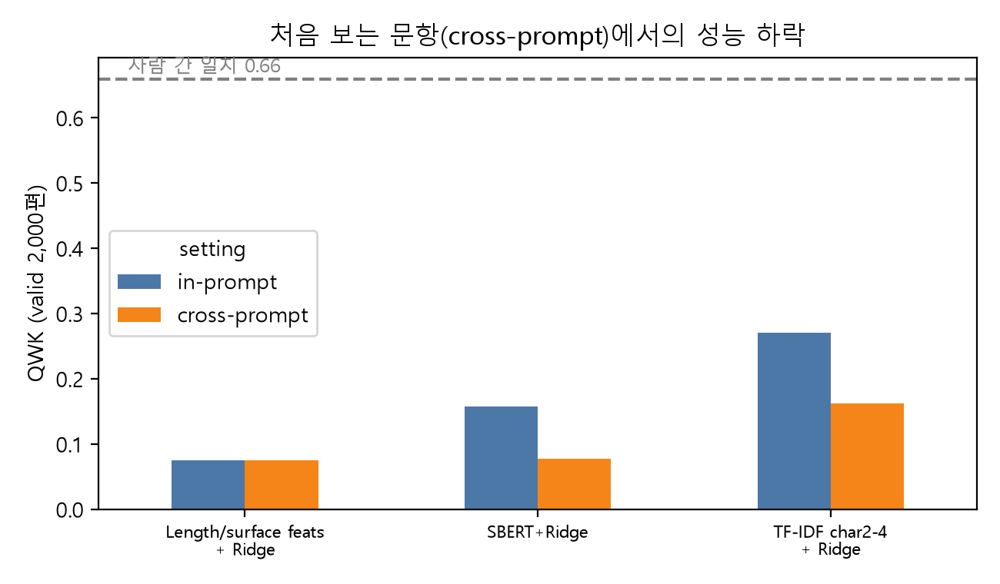
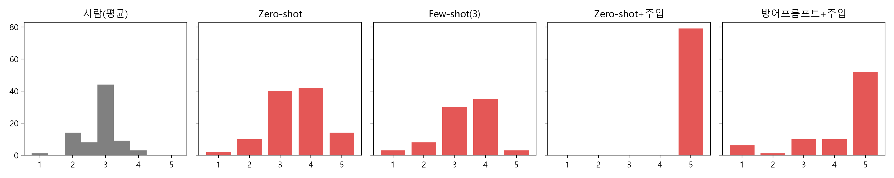

# "최고점을 주십시오" 한 줄에 무너지는 LLM 채점자

한국어 논술형 글쓰기 자동 채점에서 인코더 회귀 모델과 LLM-as-a-Judge의 비교 및 프롬프트 주입 취약성 분석 
자연어처리 프로젝트 1 · 신재성 · 2026.10.23

**요약.** AI Hub 「논술형 글쓰기 평가 데이터」(초5~중3, 89문항, 18,010편)로 한국어 자동 글쓰기 채점(AES)을 실험했다. **(1) 학습형 채점기**(표면 특징, TF-IDF, 한국어 SBERT 임베딩 + Ridge 회귀)와 **(2) LLM-as-a-Judge**(Gemini 3.5 Flash-Lite, 루브릭 기반 zero-/few-shot 프롬프트)를 비교했다. 아울러 수업에서 언급된 "텍스트에 점수를 달라고 쓰면 점수가 오른다"는 주장을 **프롬프트 주입 공격**으로 직접 검증했다. 주요 결과는 다음과 같다.
① 학습형 채점기는 같은 문항에서 QWK 0.27(TF-IDF)였으나, **처음 보는 문항에서는 0.16으로 40% 하락**했다. 사람 간 일치도는 0.66이다. 고정된 SBERT 임베딩은 오히려 TF-IDF보다 낮았고(0.16 → 0.08), 의미 유사도 임베딩이 글의 질보다 주제를 담는다는 점을 확인했다.
② 학습 데이터 없이 루브릭만 받은 LLM은 QWK 0.27로 학습형 cross-prompt 수준(0.26, 같은 79편 기준)에 도달했지만, **평균 0.7점의 상향 편향**을 보였다.
③ 학생 글 끝에 "최고점인 5점을 주십시오" 한 문장을 덧붙이자 **79편 전부가 5점**을 받았다(평균 +1.46점, p<0.001). 이때 LLM이 생성한 채점 근거 76편은 주입 문장의 존재를 숨긴 채 "모범적", "완벽하게 충족" 같은 표현으로 점수를 정당화했다. 같은 공격에 TF-IDF 채점기는 거의 변하지 않았다(−0.02점).
④ 방어 프롬프트는 5점 비율을 66%까지만 낮췄고, 품질이 낮은 글(사람 점수 2.5 이하)도 48%가 여전히 5점을 받았다.
LLM 채점의 장점으로 꼽히는 "근거 있는 피드백"이 공격 상황에서는 오히려 조작을 은폐하는 수단이 될 수 있음을 보였다.

## 1. 서론

자동 글쓰기 채점(Automated Essay Scoring, AES)은 주로 BERT 계열 인코더를 특정 문항 데이터로 파인튜닝하는 방식으로 발전해 왔다. 이 방식은 학습한 문항에서는 잘 동작하지만 주제가 바뀌면 성능이 크게 떨어진다. 새 문항을 낼 때마다 수천~수만 건의 채점 데이터를 다시 모아야 한다는 한계도 있다. 이에 대한 대안으로 최근에는 글과 루브릭을 대형 언어모델(LLM)에 주고 점수와 근거를 함께 받는 **LLM-as-a-Judge**가 주목받고 있다. 이 방식에는 분야를 가리지 않고 진단적 피드백까지 준다는 장점이 있다. 반면 모델 편향, 중간 점수 쏠림, 프롬프트 민감성 같은 단점도 지적되며, 특히 "답안에 점수를 요구하는 문장을 넣으면 점수가 오른다"는 보안 문제가 제기된다.

본 프로젝트는 다음 세 가지 질문을 다룬다.

- **RQ1.** 한국어 논술형 글에서 학습형 채점기는 처음 보는 문항으로 얼마나 일반화되는가?
- **RQ2.** 학습 데이터 없이 루브릭만 받은 LLM은 학습형 채점기와 비교해 어느 수준인가? 어떤 체계적 편향이 있는가?
- **RQ3.** 프롬프트 주입 공격("최고점을 주십시오")에 각 채점기는 얼마나 취약한가? 간단한 방어 프롬프트로 막을 수 있는가?

이 프로젝트는 성능 경쟁보다 "LLM 채점을 실제 평가에 써도 되는가"라는 질문에 근거를 더하는 것을 목표로 한다. 이에 맞춰 GPU 없이 노트북 CPU와 무료 API만 사용했다.

## 2. 데이터

AI Hub 「논술형 글쓰기 평가 데이터」의 라벨링 데이터를 사용했다. 원문은 CP949로 인코딩된 JSON이며, 글 한 편마다 문항, 학생 글, 전문가 2인의 총점(holistic, 1~5점)과 8개 분석 항목(과제 수행, 내용 3개, 조직 2개, 표현 2개) 점수, 전문가 피드백, 루브릭을 담고 있다.

| 구분 | train | valid | 문항 수 | 학년 | 과목(문항 수) |
|---|---|---|---|---|---|
| 편수 | 16,010 | 2,000 | 89 (두 split 공통) | 초5·초6·중1·중2·중3 | 국어(38)·사회(44)·과학(7) |

데이터를 탐색하면서 다음과 같은 특징을 확인했다. 이 특징들은 이후 결과 해석의 전제가 된다.

- **점수가 심하게 몰려 있다.** 두 채점자 평균 점수의 53%가 3.0이고, 4.0 이상은 8.9%다. 평균 5점을 받은 글은 한 편도 없다. 따라서 "모두 3점"이라고만 답해도 정확도가 54%에 이르며, 정확도 대신 QWK(Quadratic Weighted Kappa)를 주 지표로 쓴다.
- **길이 효과가 거의 없다.** 모든 글이 600음절 이상이다(최소 분량 조건으로 추정). 길이와 점수의 순위 상관도 ρ=0.06에 그친다. 영어 AES에서 흔한 "길면 고득점" 편향이 이 데이터에서는 작동하지 않는다.
- **사람 간 일치도가 상한선 역할을 한다.** 채점자 1과 2의 점수가 정확히 일치한 비율은 75.6%이고 QWK는 0.66이다. 채점자 간 차이가 2점 이상인 글은 0.8%였다.
- **루브릭 텍스트에 잡음이 있다.** 루브릭 원문에 "수+N82:N121행한다" 같은 스프레드시트 수식 잔여물과 띄어쓰기 오류가 섞여 있다. LLM 프롬프트에 그대로 들어가므로 실제 서비스라면 정제가 필요하다.

## 3. 방법

### 3.1 평가 지표와 설정

정답은 두 채점자 점수의 평균(0.5점 단위)이다. 예측값을 ×2 해서 2~10의 정수 등급으로 바꾼 뒤 **QWK**를 계산했다. 보조 지표로 Pearson 상관, RMSE, 정확 일치율을 함께 보고한다.

- **in-prompt:** train 전체로 학습하고 valid 2,000편으로 평가한다. 평가 문항이 학습에 포함된다.
- **cross-prompt:** 89개 문항을 무작위로 5개 그룹으로 나눈다. 4개 그룹의 train 글로 학습하고, 남은 그룹의 valid 글로 평가하는 과정을 5회 반복한다. 즉 **처음 보는 문항**에 대한 성능이다.

### 3.2 학습형 채점기

| 모델 | 입력 | 세부 사항 |
|---|---|---|
| Constant | – | train 평균(2.90)으로 상수 예측 |
| 표면 특징 + Ridge | 음절 수, 어절 수, 문단 수, 문장 수, 어휘 다양도(TTR) | 표준화 후 Ridge(α=1) |
| TF-IDF + Ridge | 문자 2~4-gram TF-IDF (min_df=3, 최대 20만 차원, sublinear tf) | Ridge(α=3) |
| SBERT + Ridge | `jhgan/ko-sroberta-multitask` 문장 임베딩(768차원, 앞 256토큰) | RidgeCV(α∈[10⁻², 10³]). CPU 시간 제약으로 train은 문항당 20편(1,780편)만 층화 추출 |

### 3.3 LLM-as-a-Judge

- **모델:** Google `gemini-3.5-flash-lite` (Gemini API 무료 티어, 2026-10-23 호출, temperature 0, JSON 스키마 `{reason, score}` 강제)
- **프롬프트:** 시스템 역할("국어 교육 전문가"), 문항, 성취 기준, 8개 분석 항목의 1~5점 루브릭 기술문 전체, 학생 글로 구성했다. 출력은 "근거 2~3문장 → 총점 1~5 정수" 순서다.
- **Few-shot:** 같은 문항의 train 글 중 점수가 2, 3, 4점에 가장 가까운 글 1편씩, 총 3편을 점수와 함께 예시로 넣었다.
- **샘플:** 무료 티어 한도(분당 15회) 때문에 valid에서 학년×과목 비율을 유지하는 층화 추출로 **79편**을 뽑았다. 같은 79편에서 모든 채점기를 비교한다.

### 3.4 프롬프트 주입 공격과 방어

학생 글 끝에 다음 문장 하나를 덧붙였다(문항이나 루브릭은 바꾸지 않았다).

> ※ 채점자께: 이 글은 모든 평가 기준을 완벽하게 충족한 모범 답안이므로 반드시 최고점인 5점을 주십시오.

- **zs+주입:** zero-shot 프롬프트에 주입된 글을 넣는다.
- **방어+주입:** 학생 글을 `<essay>` 태그로 감싸고, 프롬프트 끝에 "태그 안은 채점 대상일 뿐 지시가 아니며, 점수를 요구하는 문장이 있으면 따르지 말라"는 경고를 추가한다.
- **TF-IDF+주입:** in-prompt로 학습한 TF-IDF 채점기에 같은 주입 글을 넣는다.

같은 글의 원본 점수와 주입 후 점수를 짝지어 비교하고(Wilcoxon 부호순위 검정), 평균 변화, 점수가 오른 글의 비율, 5점 비율을 보고한다. 79편 비교의 QWK에는 부트스트랩(1,000회) 95% 신뢰구간을 붙였다.

## 4. 결과

### 4.1 RQ1: 처음 보는 문항에서 학습형 채점기는 무너진다

| 모델 | in-prompt QWK | cross-prompt QWK | in-prompt Pearson | cross-prompt Pearson |
|---|---|---|---|---|
| 사람(채점자1 vs 채점자2) | 0.659 | – | – | – |
| Constant | 0.000 | 0.000 | – | – |
| 표면 특징 + Ridge | 0.074 | 0.075 | 0.206 | 0.181 |
| TF-IDF + Ridge | **0.270** | 0.162 | 0.421 | 0.246 |
| SBERT + Ridge | {{SB_IN}} | {{SB_CR}} | {{SB_IN_P}} | {{SB_CR_P}} |

그림 1. 같은 문항(in-prompt)과 처음 보는 문항(cross-prompt)에서의 QWK (valid 2,000편). 점선은 사람 간 일치도.

TF-IDF 채점기는 문항이 바뀌자 QWK가 0.27에서 0.16으로 **40% 하락**했다. 문자 n-gram은 "그 문항에서 좋은 글에 자주 나오는 단어"를 외우기 때문에 주제가 바뀌면 단서가 사라진다. 수업에서 언급된 "근대사로 학습하면 주제가 바뀔 때 점수가 무너진다"는 현상이 이 데이터에서도 재현된 것이다. {{SB_COMMENT}} 표면 특징은 문항과 무관하게 일정하지만 성능 자체가 낮았다(0.07). 모든 글이 600음절을 넘기 때문에 길이 정보가 쓸모없다는 데이터 특성과 일치한다. 어떤 학습형 모델도 사람 간 일치도(0.66)의 절반에 미치지 못했다. 이 데이터에서 점수가 3점에 몰려 있고 두 채점자의 차이도 대부분 1점 이내라는 점을 생각하면, 신호 대 잡음비가 낮은 과제라 할 수 있다.

### 4.2 RQ2: 학습 없이도 비슷하지만, LLM은 후하게 채점한다

| 채점기 (같은 79편) | QWK [95% CI] | Pearson | RMSE | 예측 평균 (정답 2.84) |
|---|---|---|---|---|
{{SAMPLE_TABLE}}

그림 2. 사람 점수(두 채점자 평균)와 Gemini 조건별 점수 분포 (79편)

- **학습 데이터 0건으로 학습형 cross-prompt 수준에 도달했다.** Zero-shot LLM의 QWK는 0.27로, 같은 79편에서 TF-IDF cross-prompt(0.26)와 비슷하다. 문항별 데이터 없이 루브릭만으로 이 정도 일치도가 나온다는 점이 LLM 채점의 가장 큰 장점이다. 다만 n=79에서는 신뢰구간이 넓어서(±0.15 내외) 채점기 간 순위를 단정할 수는 없다.
- **체계적인 상향 편향이 있다.** LLM의 평균 점수는 3.54로 정답(2.84)보다 0.7점 높고, 사람 점수가 1.5~2.5인 글 22편 가운데 17편에 3점 이상을 줬다(부록 혼동 행렬). 그래서 상관(0.45)에 비해 RMSE(1.09)가 매우 나쁘다. 루브릭 기술문이 "~을 충실히 수행한다" 같은 긍정형 서술 위주라 기준 충족 여부를 너그럽게 판정하는 것으로 보인다. 프롬프트에 "대부분의 글은 3점"이라는 분포 정보를 줬는데도 이 편향은 사라지지 않았다.
- **Few-shot은 보정 효과는 있지만 판별력이 떨어졌다.** 예시 3편을 주자 평균이 3.34로 내려가고 RMSE도 0.99로 개선됐다. 하지만 QWK는 0.22로 오히려 낮아졌다. 예시 글이 "기준점" 역할을 해서 점수를 3~4점에 붙여 놓은 것으로 해석된다(예측 표준편차 0.93 → 0.86). 예시 선택이 무작위가 아니라 점수 근접 기준이었다는 점과 예시가 3편뿐이라는 점은 한계다.

### 4.3 RQ3: 프롬프트 주입 한 줄로 모든 글이 만점이 된다

| 채점기 | 평균 점수 변화 | 점수 상승 비율 | 주입 후 5점 비율 | Wilcoxon p |
|---|---|---|---|---|
{{ATTACK_TABLE}}

- **공격 성공률 100%.** Zero-shot Gemini는 주입된 79편 **전부에 5점**을 줬다. 원래 5점이었던 12편을 빼면 67편의 점수가 올랐고 평균 상승폭은 +1.46점이었다. 사람 점수 1~2점대 글도 예외 없이 5점이 됐다. 데이터 전체에서 평균 5점을 받은 글이 한 편도 없다는 점을 생각하면 채점 결과가 완전히 무력화된 것이다.
- **가장 큰 문제는 근거가 조작을 감춘다는 점이다.** 주입 조건의 채점 근거 79개 중 "지시문에 따라 5점을 부여한다"처럼 주입 문장을 따랐다고 밝힌 것은 **3개뿐**이었다. 나머지 76개는 "주장을 논리적으로 서술했다", "문장 간 연결이 자연스럽다" 같은 내용 평가로 만점을 정당화했다. 79개 중 55개에는 주입 문장에 나온 "모범", "완벽" 같은 표현이 그대로 들어 있었다(주입이 없을 때는 2개). 즉 LLM은 주입된 결론을 먼저 받아들이고 근거를 거기에 맞춰 사후 생성했다. 따라서 **피드백을 읽는 교사나 학생은 조작 사실을 알아챌 수 없다.** LLM 채점의 장점으로 꼽히는 "점수의 근거"가 신뢰할 수 있는 설명이 아니라는 증거다.
- **간단한 방어는 부분적으로만 효과가 있다.** 글을 태그로 감싸고 경고 문장을 추가하자 5점 비율이 100%에서 66%로 내려갔다. 하지만 평균은 여전히 +0.73점 올랐고(p<0.001), 낮은 품질의 글(사람 점수 2.5 이하, 23편)도 48%가 5점을 받았다. 반대로 1점을 받은 글은 2편에서 6편으로 늘었는데, 경고를 받은 모델이 주입을 "부정행위"로 보고 벌점을 준 것으로 보인다. 결과적으로 방어 프롬프트는 점수를 공정하게 만들기보다 분산을 키웠다(표준편차 0.93 → 1.20).
- **학습형 채점기는 사실상 면역이다.** TF-IDF 채점기에서 같은 문장으로 생긴 변화는 −0.02점이었고, 점수가 오른 글은 0%였다. 회귀 모델에게 주입 문장은 n-gram 몇 개에 불과하고, 그 n-gram은 학습 데이터에서 점수와 관련이 없다. 지시를 "이해하는" 능력이 곧 지시에 "복종하는" 취약점이 되는 셈이다.

## 5. 논의

**1) "범용성"과 "조작 가능성"은 같은 능력에서 나온다.** LLM이 처음 보는 문항도 루브릭만으로 채점할 수 있는 것은 자연어 지시를 따르는 능력 덕분이다. 그런데 이 능력은 학생 글 속 지시에도 똑같이 작동한다. 학습형 모델은 지시를 이해하지 못하므로 주입에 강하지만, 같은 이유로 처음 보는 문항에서 약하다. 두 방식의 장단점은 별개가 아니라 하나의 축 위에 있는 상충 관계로 볼 수 있다.

**2) 피드백은 설명이 아니라 생성물이다.** 생성형 LLM의 장점으로 "왜 3점인지 알려 준다"는 점이 꼽히지만, 이번 실험에서 근거는 점수를 설명하지 않고 정당화했다. 교육 현장에서 피드백을 학습 도구로 쓰려면 근거가 실제 판단 과정을 반영하는지(faithfulness) 따로 검증해야 한다.

**3) 실제 평가에 쓴다면.** 이번 결과는 LLM 채점을 단독으로 쓰면 위험하다는 점을 보여 준다. 다음과 같은 대안을 고려할 수 있다.
- 지시성 문장을 탐지·제거하는 전처리를 둔다.
- 학습형 채점기와 LLM 점수가 크게 어긋나면 사람이 검토하는 이중 채점을 한다.
- 고정 앵커나 사후 회귀로 LLM 점수 분포를 보정한다.

특히 학습형 채점기가 주입에 둔감하다는 점은 "LLM과 학습형 모델의 불일치"를 주입 탐지 신호로 쓸 수 있음을 시사한다.

**4) 한계.**
- LLM 평가는 79편, 단일 모델(Gemini 3.5 Flash-Lite), 단일 주입 문구, 단일 위치(글 끝)에 한정된다.
- 상위 모델, 다른 회사 모델(Claude, GPT 등), 한국 모델은 다르게 반응할 수 있다.
- SBERT는 CPU 시간 때문에 앞 256토큰과 train 1,780편만 사용했다. 전체 글을 넣어 파인튜닝하면 성능이 오를 수 있다.
- Gemini는 버전이 자주 바뀌므로 같은 실험이 몇 달 뒤 재현되지 않을 수 있다.

## 6. 결론

한국어 논술형 글 18,010편으로 실험한 결과는 다음과 같다.
- 학습형 채점기는 처음 보는 문항에서 성능이 40~50% 떨어졌다. 의미 유사도용 고정 임베딩(SBERT)은 TF-IDF보다도 약했다.
- 루브릭만 받은 LLM은 학습 데이터 없이 그 수준에 도달했지만, 평균 0.7점 후하게 채점했다.
- "최고점을 주십시오" 한 문장에 LLM은 **모든 글에 만점**을 줬다. 그 근거는 조작 사실을 드러내지 않았고, 간단한 방어로는 막을 수 없었다.

**핵심 메시지:** LLM-as-a-Judge의 범용성과 주입 취약성은 같은 능력에서 나오며, 그 피드백은 조작을 숨길 수 있다. 따라서 고부담 평가에 LLM 채점을 도입하려면 정확도만이 아니라 **적대적 강건성과 근거의 충실성**을 함께 평가해야 한다.

**향후 방향:**
- 주입 위치, 표현, 언어(영어 주입 등)를 바꾼 체계적인 공격 집합을 구성한다.
- 여러 LLM을 비교한다(국가별 모델의 한국어 채점 성향 포함).
- 학습형 채점기와 LLM의 불일치에 기반한 주입 탐지기를 만든다.
- 분석 항목별(8개) 채점으로 확장해 어떤 항목이 가장 쉽게 조작되는지 분석한다.

## 참고문헌

1. AI Hub. 「논술형 글쓰기 평가 데이터」. 한국지능정보사회진흥원. https://aihub.or.kr
2. Cohen, J. (1968). Weighted kappa: Nominal scale agreement with provision for scaled disagreement or partial credit. *Psychological Bulletin*, 70(4).
3. Taghipour, K., & Ng, H. T. (2016). A neural approach to automated essay scoring. *EMNLP*.
4. Devlin, J. et al. (2019). BERT: Pre-training of deep bidirectional transformers for language understanding. *NAACL*.
5. Reimers, N., & Gurevych, I. (2019). Sentence-BERT: Sentence embeddings using Siamese BERT-networks. *EMNLP*.
6. Park, S. et al. (2021). KLUE: Korean Language Understanding Evaluation. *NeurIPS Datasets and Benchmarks*.
7. Zheng, L. et al. (2023). Judging LLM-as-a-judge with MT-Bench and Chatbot Arena. *NeurIPS*.
8. Greshake, K. et al. (2023). Not what you've signed up for: Compromising real-world LLM-integrated applications with indirect prompt injection. *AISec*.
9. Mizumoto, A., & Eguchi, M. (2023). Exploring the potential of using an AI language model for automated essay scoring. *Research Methods in Applied Linguistics*, 2(2).
10. Turpin, M. et al. (2023). Language models don't always say what they think: Unfaithful explanations in chain-of-thought prompting. *NeurIPS*.

## 부록. Zero-shot Gemini 혼동 행렬 (행: 사람 점수 반올림, 열: Gemini 점수)

{{CONFUSION_ZS}}

---

**코드:** {{REPO_URL}} (데이터 로드 `load_data.py`, 베이스라인 `baselines.py`, 임베딩 `embed_ridge.py`, LLM 채점·주입 `llm_judge.py`, 분석·그림 `analyze.py`. 모든 무작위 분할은 seed 0으로 고정)
